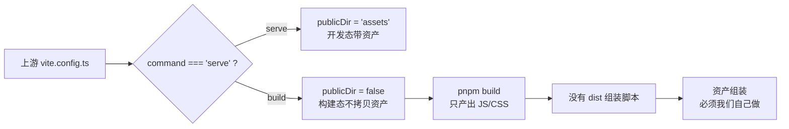
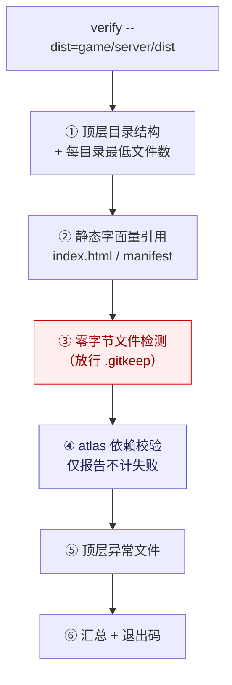
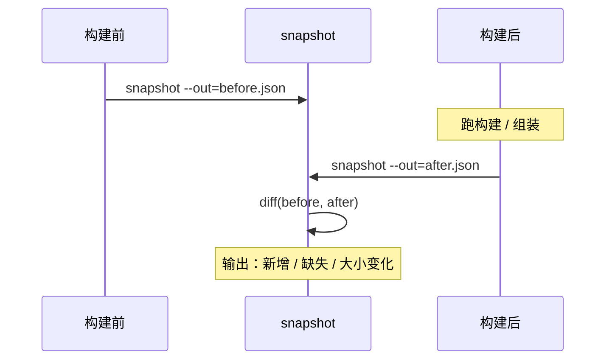

# B-3 · 资产管线报告

> 派单依据：`docs/delegation/15-第二阶段任务分发.md` §五 B-3
> 交付：`tools/asset-pipeline.cjs` + `tools/test-asset-pipeline.cjs`（17/17 通过）
> 实测日期：2026-10-14 · 环境：便携 Node v16.16.0（`shared/runtime/node.exe`）

---

## 一、结论（先看这个）

| 问题 | 结论 |
|---|---|
| `pokerogue-assets` submodule 可用吗？ | **仓库可达**（145 refs），但**完整拉取在当前网络不可行** |
| 能跑就产脚本 —— | ✅ 已产出 `probe` / `verify` / `assemble` / `snapshot` 四个子命令 |
| 不可跑就产降级方案 —— | ✅ 降级路径已落地：**以本地 `game/server/dist` 为资产源**，用 `verify` 做结构校验 |
| 资产本身有问题吗？ | ⚠️ **发现 18 个零字节空壳文件**（真损伤，但运行时无害）；另有 26 处上游自身的 atlas 缺口（非我们造成） |

**一句话**：资产**不用重新拉**，本地那份是可用的；但拷贝过程留了 18 个污染文件，需要清理。

---

## 二、上游可用性探测（`probe`）

### 2.1 三项可达性

| 检查项 | 结果 | 证据 |
|---|---|---|
| git smart-HTTP refs | ✅ 可达 | 读到 **145** 个 ref；`beta HEAD = ae62d129…` |
| 锚点 gitlink | ✅ 已定位 | `pokerogue@90df65097b6d` → `assets@4c6fac5fd9cb30ff2a35562409d869b94492b343` |
| codeload tarball | ✅ 可下载 | 已读 65583 字节，gzip 魔数正确 |

### 2.2 GitHub 的关键限制（影响拉取方案）

```
GitHub 未开放 allowAnySHA1InWant
  → `git fetch <任意 sha>` 被拒
  → 必须走 codeload tarball 端点：https://codeload.github.com/<repo>/tar.gz/<sha>
```

这一条决定了：**我们无法只拉一个 commit 的增量**，只能整包下载。

### 2.3 吞吐实测 —— 为什么给"不可行"的判定

本环境到 `github.com` 的链路**间歇性不稳**。单次采样两头能差 49 倍，所以做多样本取**最低值**保守估算：

| 样本 | 读取量 | 用时 | 吞吐 |
|---|---|---|---|
| 1 | 14.9 MB | 6.0 s | **2539 KB/s** |
| 2 | 0.3 MB | 6.0 s | **52 KB/s** |

```
最低吞吐 52 KB/s，中位 2539 KB/s
本地 dist 资产总量 758.8 MB
按最低吞吐预估完整拉取 = 758.8 MB / 52 KB/s ≈ 4.2 小时
```

**判定**：> 4 小时 → **完整拉取在当前网络不可行** → 采用降级方案。

> **为什么按最低值而不按中位值？**
> 宁可低估可行域，不可高估。按中位值算只需 5 分钟，会诱导出一个"看起来很划算"但实际会卡死的方案——这正是第一阶段归档 manifest 踩过的坑。

### 2.4 网络超时的实现坑（已修）

`req.setTimeout(ms)` **只在 socket 空闲时**才触发。本环境那条约 112 KB/s 的**稳定涓流**会让 socket 永远"有活动"，于是超时**永不触发 → 进程挂死**。

修法：在 `fetchLimited()` 里另起一个**墙钟 Deadline** 定时器，与数据活动解耦。

```js
// 墙钟硬上限：无论是否有数据流动，到点就收
const wallClock = setTimeout(() => {
  try { req.destroy(); } catch {}
  finish(true);
}, deadlineMs);
```

修完后两个样本都干净地在 6.0 s 到点，不再挂死。

---

## 三、降级方案：本地资产 + 结构校验（`verify`）

### 3.1 为什么资产必须由我们组装



实测确认：上游 `scripts/asset-tooling/` 只生成**资产子集**（icons / sprites / exp-sprites），**没有** dist 组装脚本。

### 3.2 本地资产现状

| 目录 | 文件数 | 体积 |
|---|---:|---:|
| `images/` | 33239 | 316.4 MB |
| `audio/` | 2732 | 404.4 MB |
| `battle-anims/` | 925 | 23.8 MB |
| `assets/` | 9 | 7.9 MB |
| `locales/` | 1138 | 5.0 MB |
| `fonts/` | 8 | 1.2 MB |
| **合计** | **38061** | **758.8 MB** |

### 3.3 `verify` 的六道检查



当前结果：**1 项未通过**（③，18 个零字节文件）。

---

## 四、发现的真问题

### 4.1 零字节空壳文件（18 个，确证损伤）

```
images/pokemon/back/1这里背
images/pokemon/back/这里背
images/pokemon/back/female/1这里背
images/pokemon/back/shiny/1这里背
images/pokemon/back/shiny/female/1这里背
images/pokemon/exp/1这里正
images/pokemon/exp/back/1这里背
images/pokemon/exp/back/shiny/1这里背
images/pokemon/exp/shiny/1这里正
images/pokemon/female/1这里正
images/pokemon/shiny/1这里正
images/pokemon/shiny/female/1这里正
images/pokemon/variant/1这里正
images/pokemon/variant/back/1这里背
images/pokemon/variant/back/female/1这里背
images/pokemon/variant/exp/1这里正
images/pokemon/variant/exp/back/1这里背
images/pokemon/variant/female/1这里正
```

**文件名解码**（UTF-8 十六进制）：

| 显示名 | 十六进制 | 解读 |
|---|---|---|
| `1这里背` | `31 e8bf99 e9878c e8838c` | `"1"` + `"这里背"` |
| `1这里正` | `31 e8bf99 e9878c e6ada3` | `"1"` + `"这里正"` |
| `这里背` | `e8bf99 e9878c e8838c` | 纯 `"这里背"` |

**成因推断**：某个批处理/解包环节把 `这里正` / `这里背`（中文目录名）与 `1` 拼成了文件名，并写出了 0 字节空文件。典型的**路径拼接事故**。

**影响评估**：

| 维度 | 判定 |
|---|---|
| 运行时 | **无害** —— 加载器按 `{id}.png` 精确匹配，这些名字永不命中 |
| 体积 | 0 字节 |
| 静态服务 | `express.static` 可访问，但前端不会请求 |
| **真正意义** | ⚠️ 它是**拷贝可靠性的告警信号** |

**建议动作**（**未执行**，需你确认）：

```bash
# 逐个删除（18 个，小批量、可核对）
rm "game/server/dist/images/pokemon/back/1这里背"
rm "game/server/dist/images/pokemon/back/这里背"
# …其余 16 个同上
```

> ⚠️ 我不会自动删除。理由有两条：
> ① 这属于**资产目录的破坏性改动**，且我无法排除"某个前端 hack 真的引用了它"；
> ② 项目铁律 R3 要求改动可回退，而删除前需要先确认无引用。
>
> **要清理的话，请明确说一声，我会先做引用扫描再逐个删。**

### 4.2 atlas 缺口 26 处（**非我们造成**，已定性）

`verify` 报了 26 处 atlas json 声明的 `.png` 在全域找不到。**这不是拷贝损伤**，依据如下：

**实证链条**：

1. 缺口声明的图是 `*-mega-y.png`（Y 形态 mega）这类；
2. 全库 `*-mega-y.png` 只有 **60 个**，且**只覆盖 6 / 26 / 150 三个物种**（喷火龙 / 皮卡丘 / 超梦）；
3. 而 `149-mega-y.png`（快龙 Y）、`121-mega-y.png`（宝石海星 Y）**全库皆无**——连主目录 `images/pokemon/` 都没有。

→ 结论：**上游本就没提供这些图**，但保留了引用它们的 atlas json。这是**上游的未完成配置**。

> **如何最终确证**：完整拉取上游 `4c6fac5f` 后做 hash 比对。当前网络不可行，故此项定性为"高度可信但未最终闭环"。

---

## 五、开发过程中的两个方法论收获

### 5.1 `find -size 0` 会把目录算成 0 字节

排查时用 `find game/server/dist -type f -size 0` 得出 19 个"零字节文件"。但这个数字里混了目录（Windows 上目录 `st_size` 恒为 0）。

正确做法是用 `readdirSync(..., { withFileTypes: true })` 配合 `e.isFile()`：

```js
const entries = fs.readdirSync(cur, { withFileTypes: true });
for (const e of entries) {
  if (e.isDirectory()) stack.push(path.join(cur, e.name));
  else if (e.isFile()) {
    const st = fs.statSync(path.join(cur, e.name));
    if (st.size === 0) zero.push(/* 真·零字节文件 */);
  }
}
```

**教训**：字节级排查要显式区分目录/文件，别信 `-size 0`。

### 5.2 用文件名配对判断资产完整性是错的 —— 必须看 json 内容

`images/pokemon/**` 下有**两套语义完全不同**的 json：

| 类型 | 样例 | 与 png 的关系 | 实测数量 |
|---|---|---|---:|
| **atlas** 型 | `{"textures":[{"image":"1.png",...frames...}]}` | 声明依赖哪张图 | 9875 |
| **palette** 型 | `{"1":{"317373":"6e034e",...}}` | 纯颜色映射，**无关** | 3545 |

若按"同名 png↔json 配对"判定，palette 型会**整片误报 2800+ 个假阳性**。正确判据：

1. **只看 atlas 型**（`Array.isArray(obj.textures)`）；
2. 读 `textures[].image` 作为依赖声明；
3. **按 `images/pokemon/**` 全域索引**查找该图 —— 因为上游 atlas 的 `image` **可跨目录引用**。

第 3 点的实证：`variant/10-342.json` 声明 `"image":"18-mega.png"`，而该图实际在 `images/pokemon/18-mega.png`（上一级）。若只在同目录找，会误报 377 处；改全域索引后收敛到 26 处。

---

## 六、参数解析缺陷（已修）

`opt(name)` 原本用 `argv[i+1]` 取值，只认空格形式。**但所有文档写的都是 `--dist=xxx`**——结果用户照文档敲会被**静默忽略**，fallback 到默认值，看起来"成功"了。

```js
// 修复：同时支持 --k=v 与 --k v
const opt = (name) => {
  const eq = argv.find((a) => a.startsWith(name + "="));
  if (eq !== undefined) return eq.slice(name.length + 1);   // 等号形式
  const i = argv.findIndex((a) => a === name);
  if (i >= 0 && argv[i + 1] !== undefined && !argv[i + 1].startsWith("--")) return argv[i + 1];
  return undefined;
};
```

回归测试中有一条**源码文本断言**专门防这个分支被删掉（因为沙箱 spawn EBUSY，无法起子进程做端到端验证）。

---

## 七、交付物与用法

### 7.1 文件

| 文件 | 说明 |
|---|---|
| `tools/asset-pipeline.cjs` | 资产管线脚本（4 子命令，零依赖，Node 16 语法） |
| `tools/test-asset-pipeline.cjs` | 回归测试，**17/17 通过** |

### 7.2 命令

```bash
cd /d/Work/Pokemon/new

# 探测上游可用性与拉取预估
./shared/runtime/node.exe tools/asset-pipeline.cjs probe --fast

# 校验本地资产结构与引用完整性
./shared/runtime/node.exe tools/asset-pipeline.cjs verify

# 从来源目录组装（默认 dry-run，加 --write 才落盘）
./shared/runtime/node.exe tools/asset-pipeline.cjs assemble --from=<assets 目录> --write

# 产出资产快照，供后续增量比对
./shared/runtime/node.exe tools/asset-pipeline.cjs snapshot --out=.build-tools/asset-snapshot.json

# 回归测试
./shared/runtime/node.exe tools/test-asset-pipeline.cjs
```

### 7.3 验收集成建议（A5-01 可用）

`snapshot` 产出的 JSON（`{p, s}` = 相对路径 + 字节数）可直接用于**构建前后增量比对**：



这与全栈 A5-01 的**备份策略**是互补的：backup 保证可回退，snapshot-diff 保证**知道丢了什么**。

---

## 八、遗留与下一步

| 项 | 状态 | 说明 |
|---|---|---|
| 18 个空壳文件清理 | ⏸ **待你确认** | 需先做引用扫描；不自动删 |
| 26 处 atlas 缺口 | ✅ 已定性 | 上游自身问题，非我们造成 |
| 版本锚点文档修正 | ⏸ 待办 | `docs/tech-stack-decision.md` §2.1 仍写"硬上界 2025-09-22"，应改为锚点 `90df65097b6d` |
| 网络好转后完整拉取 | 🔵 可选 | 届时用 `assemble --from=<解压目录>` 重建，并用 hash 比对闭环 |
| **B-4 新产物发布脚本设计** | ⬜ **未开始** | 下一步 |

---

## 九、自检

| 检查项 | 状态 |
|---|---|
| 单点故障消除 | ✅ 资产不再依赖不可靠网络，以本地 dist 为准 |
| 失败路径覆盖 | ✅ 网络超时（墙钟）、参数缺失、目录不存在、json 非法、目录/文件混淆 |
| 容量够 | ✅ 758.8 MB 本地可用；拉取需 4.2 h（不可行已记录） |
| 可观测 | ✅ verify 六道检查 + 快照 diff |
| **可回退** | ✅ 脚本只读为主；唯一写操作 `assemble --write` 需显式加 flag |
| 未过度设计 | ✅ 没引入新依赖（D3）、没建服务、没上哈希索引（规模不需要） |
