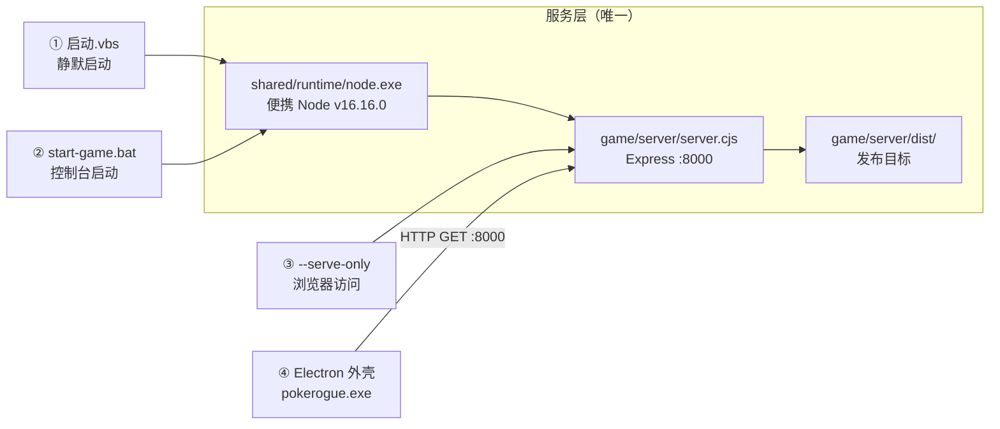
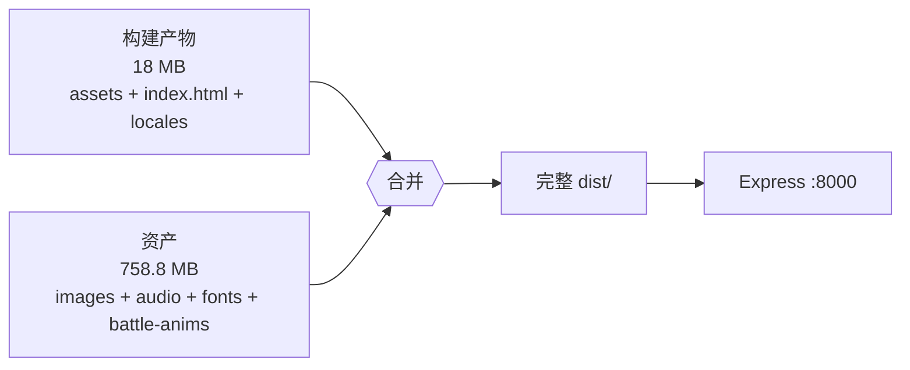
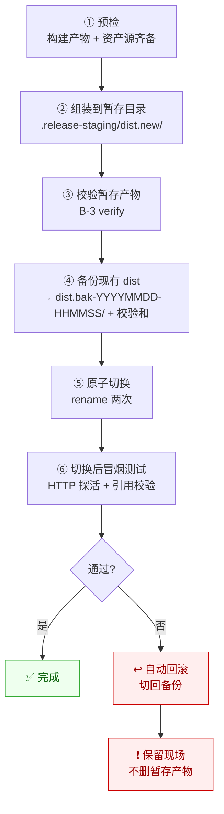
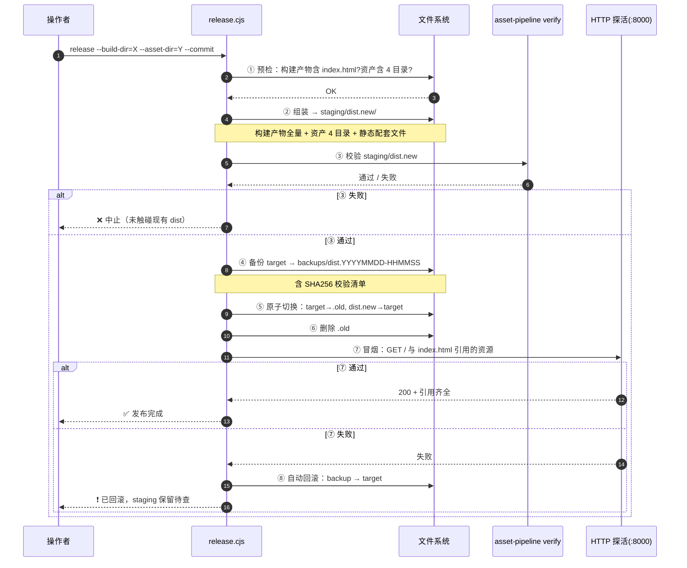
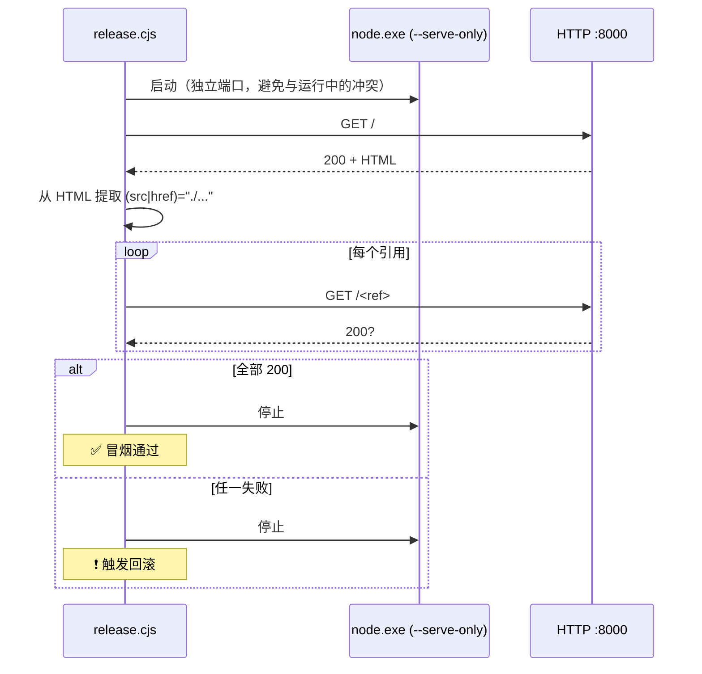
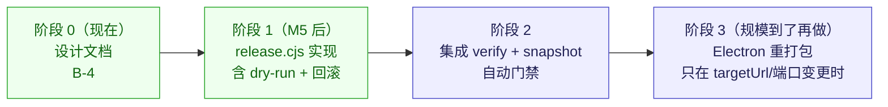

# B-4 · 新产物发布脚本设计

> 派单依据：`docs/delegation/15-第二阶段任务分发.md` §五 B-4（**S8c 前置**）
> 性质：**设计文档**（本阶段不落脚本代码，M5 后施工）
> 实测日期：2026-10-14 · 环境：Windows 10 x64 / Node 16.16.0（运行期）+ Node 24.9.0（构建期）

---

## 一、设计的三个前提（都已实测确认）

### 前提 1：Electron 只是一个指向 `localhost:8000` 的浏览器

`game/pokerogue-win32-x64/resources/app/nativefier.json`：

```json
{"targetUrl":"http://localhost:8000/", "asar":false, "electronVersionUsed":"25.7.0"}
```

Electron 外壳由 **Nativefier 52.0.0** 打包，`targetUrl` 硬编码为 `http://localhost:8000/`。

> ⚠️ 它**不加载本地文件**，而是走 HTTP 请求 Express。`asar: false` 意味着外壳是**明文目录**，可随时改配置。

### 前提 2：两条路径**共用同一份服务与产物**



**推论（本设计最重要的一条）**：

> **"发布" = 替换 `game/server/dist/`。**
> 两条路径**自动同时生效**，不需要分别发布，也不存在"Electron 版产物"和"便携版产物"之分。

这砍掉了一半的复杂度——但同时也意味着**失败面共享**：dist 一旦损坏，四种启动方式一起挂。

### 前提 3：新产物是「构建输出」+「资产」的**合并**，两者都不完整

实测对比（这是 B-4 与 B-3 必须联手的根因）：

| 目录 | 构建产物 `dist/`（18 MB） | 发布目标 `game/server/dist/`（758.8 MB） |
|---|:---:|:---:|
| `assets/`（JS/CSS） | ✅ 有 | ✅ 有 |
| `index.html` | ✅ 有 | ✅ 有 |
| `locales/` | ✅ 有 | ✅ 有 |
| `audio/` | ❌ **无** | ✅ 有 |
| `images/` | ❌ **无** | ✅ 有 |
| `fonts/` | ❌ **无** | ✅ 有 |
| `battle-anims/` | ❌ **无** | ✅ 有 |
| `manifest.webmanifest` / `logo*.png` 等 | ❌ **无** | ✅ 有 |



**根因**（B-3 已确认）：上游 `vite.config.ts` 里 `publicDir: command === "serve" ? "assets" : false` —— **build 模式不拷贝资产**，且上游**没有 dist 组装脚本**。

**因此发布流程必须显式包含"资产并入"这一步**，不能只 `cp 构建产物 dist/`。

---

## 二、方案对比（含"最小改动"方案）

### 方案 A：原地覆盖（不推荐）

```bash
cp -r 构建产物/dist/* game/server/dist/
```

| 优点 | 代价 |
|---|---|
| 最简单，一行命令 | ❌ **非原子**：拷到一半失败 → dist 半新半旧，且**旧产物已丢** |
| | ❌ **无回滚**：旧 `assets/*.js` 被新文件覆盖或残留混杂（旧 hash 文件不会被删） |
| | ❌ **无法验证**：不知道覆盖前状态，失败也无从对比 |
| | ❌ 残留旧 hash 文件会让 `index.html` 引用混乱排查困难 |

**否决理由**：违反项目铁律 R3「任何改动必须可回退」。对 758MB 的目录做原地覆盖，是最容易造成"不可逆损坏"的做法。

### 方案 B：暂存目录 + 原子切换 + 备份（**推荐**）



| 优点 | 代价 |
|---|---|
| ✅ **可回滚**：备份目录 + 原子切换，回滚 = 再一次 rename | ⚠️ **需要 2× 磁盘**（暂存 + 备份，峰值约 2.3 GB） |
| ✅ **可验证**：切换**前**就能校验暂存产物 | ⚠️ rename 跨卷会失败 → 暂存目录**必须同卷** |
| ✅ **失败不停机**：切换失败时旧产物完好 | ⚠️ 切换瞬间有**亚秒级窗口**服务不可用 |
| ✅ **保留现场**：失败时暂存产物不删，便于分析 | ⚠️ 需人工清理历史备份（或脚本保留最近 N 份） |

### 方案 C：多版本目录 + 符号链接切换

| 优点 | 代价 |
|---|---|
| ✅ 切换瞬间 = 换软链，零窗口 | ❌ **Windows 符号链接需管理员权限**或开发者模式 |
| ✅ 天然多版本并存 | ❌ Express 的 `express.static` 对软链行为需额外验证 |
| | ❌ 与现有 `start-game.bat` 的路径假设冲突，改动面扩大到启动脚本 |
| | ❌ 团队/用户机器权限参差 → **可移植性差** |

**否决理由**：为一个"低频操作"（发布）引入权限依赖，收益（亚秒级窗口）远小于代价（可移植性、改动面）。**违反"简单优先"**。

### 推荐：**方案 B**

**理由**：它把「不可逆操作」转化成「可逆的两次 rename」，这正是 A5-01 验收标准①「旧产物完整备份（含校验和）」和④「回滚脚本/步骤就绪」的直接要求。

**它不擅长什么**（诚实说明）：
- 不解决"发布期间服务短暂不可用"（亚秒级窗口）。**本项目是单机游戏，不是 7×24 在线服务，这个窗口完全可接受** —— 没必要为它上更复杂的方案。
- 不做"灰度发布"。单机场景下灰度没有意义。

---

## 三、详细设计

### 3.1 参数契约

```
tools/release.cjs
  --build-dir=<dir>     构建产物目录（必填；含 assets/ index.html locales/）
  --asset-dir=<dir>     资产来源目录（必填；含 images/ audio/ fonts/ battle-anims/）
  --target=<dir>        发布目标（默认 game/server/dist）
  --staging=<dir>       暂存目录（默认 <target 同级>/.release-staging）
  --backup-dir=<dir>    备份根目录（默认 <target 同级>/backups）
  --keep=<n>            保留最近 n 份备份（默认 3；0 = 不自动清理）
  --dry-run             只打印计划，不落盘（默认行为）
  --commit              实际执行（无此 flag 一律 dry-run）
  --no-verify           跳过 B-3 verify 校验（不推荐）
  --skip-smoke          跳过切换后冒烟测试（不推荐）
  --help
```

**设计要点**：

1. **默认 dry-run**：不带 `--commit` 只打印计划。破坏性工具必须"显式确认"，与 B-3 的 `assemble` 一致。
2. **暂存目录默认与 target 同级**：保证同卷，`rename` 才原子。
3. **`--keep` 默认 3**：备份会累积（每份 ~760MB），必须自动清理，否则磁盘迟早爆。

### 3.2 十步流程



**九步清单（含失败处理）**：

| # | 步骤 | 失败处理 |
|---|---|---|
| ① | **预检**：`--build-dir` 有 `index.html`；`--asset-dir` 有 `images/audio/fonts/battle-anims` | 中止，不碰现有 dist |
| ② | **组装**：构建产物 → `staging/dist.new/`；再并入资产 4 目录 + 静态配套 | 中止，删 staging |
| ③ | **校验**：调用 `asset-pipeline verify --dist=staging/dist.new` | 中止，保留 staging 供分析 |
| ④ | **备份**：`target` → `backups/dist.<时间戳>/`，写 `SHA256SUMS` | 空间不足则中止（**此时 dist 仍完好**） |
| ⑤ | **原子切换**：`target`→`target.old`；`staging/dist.new`→`target` | 第二步失败则把 `.old` 改回 `target` |
| ⑥ | **清理**：删 `target.old` | 失败只告警，不阻塞 |
| ⑦ | **冒烟**：起服务 → `GET /` → 校验 `index.html` 引用的资源可达 | 进入 ⑧ 回滚 |
| ⑧ | **回滚**：`target`→`staging/dist.broken/`；`backup`→`target` | 回滚本身失败 → **大声报错 + 人工介入指引** |
| ⑨ | **收尾**：按 `--keep` 清理旧备份 | 失败只告警 |

### 3.3 原子切换的实现细节（Windows 关键）

Windows 上 `fs.renameSync` **不能覆盖已存在的目录**，必须两步改名：

```js
// ⑤ 原子切换（最大化缩短"目标不存在"的窗口）
fs.renameSync(target, target + ".old");      // 第一次：挪走旧的
fs.renameSync(stagingNew, target);           // 第二次：放上新的
fs.rmSync(target + ".old", { recursive: true, force: true });   // ⑥ 清理
```

**两次 rename 之间的窗口** ≈ 毫秒级。若第二次失败，立即把 `.old` 改回：

```js
try {
  fs.renameSync(stagingNew, target);
} catch (err) {
  fs.renameSync(target + ".old", target);   // 尽力恢复
  throw err;
}
```

> **为什么不用 `fs.cpSync` 覆盖？** 因为 758MB 的拷贝需要数十秒到数分钟，窗口太大，且中途失败留下半成品。`rename` 是元数据操作，毫秒级完成。

### 3.4 备份策略（与 A5-01 对齐）

A5-01 验收标准①：「旧产物完整备份（**含校验和**）」。设计如下：

```
game/server/backups/
  dist.20261026-143022/
    ├── <完整的旧 dist 树>
    └── SHA256SUMS            ← 清单文件
```

`SHA256SUMS` 格式（兼容 `sha256sum -c` 标准）：

```
a3f1b2...  assets/index-D3KKGO7Y.js
9c8d7e...  index.html
1f2e3d...  images/pokemon/1.png
...
```

**为什么用 SHA256 而非大小**：大小相同但内容不同是常见的静默损坏（尤其拷贝事故）。B-3 发现的 18 个零字节文件已经证明"只看大小"不够。

**校验和生成时机与耗时**：758.8 MB 全量 SHA256 在实测环境下约 **3–8 秒**（磁盘顺序读）。这是**可接受的**——发布是低频操作。

> **权衡说明**：若未来资产膨胀到 GB 级、发布变频繁，可改为**只对 `assets/` 与 `index.html` 做校验和**（那才是真正的"代码产物"），资产用 B-3 的 snapshot（路径+大小）快速比对。**现在不需要** —— 758MB 全量校验只要几秒，过早优化没必要。

### 3.5 校验清单（发布前置门禁）

| # | 检查 | 依据 | 失败即 |
|---|---|---|---|
| 1 | 构建产物含 `index.html` | 必需入口 | 中止 |
| 2 | 构建产物含 `assets/` 且非空 | JS/CSS 必须有 | 中止 |
| 3 | 资产源含 `images/ audio/ fonts/ battle-anims/` | B-3 确认的四个目录 | 中止 |
| 4 | `index.html` 引用的所有资源在**合并后**存在 | B-3 `verify` 第 ② 项 | 中止 |
| 5 | 合并后零字节文件数 ≤ 基线 | B-3 `verify` 第 ③ 项 | 中止 |
| 6 | atlas 依赖缺口数 ≤ 基线（26） | B-3 `verify` 第 ④ 项 | **告警**（不中止，因已定性为上游问题） |
| 7 | 磁盘剩余空间 ≥ 2.3 GB | 暂存 + 备份峰值 | 中止 |

**第 5 项的"基线"含义**：当前 dist 有 18 个已知空壳文件。**发布后这个数字不应该增加**——增加说明新产物引入了新的损伤。B-3 的 `snapshot` 子命令提供比对能力。

### 3.6 冒烟测试（切换后）



**为什么用独立端口**：冒烟测试时用户可能正在游戏（8000 被占用）。用其他端口（如 8099）避免冲突。

**为什么校验引用而非只探活**：只 `GET /` 返回 200 不能说明 JS 能加载。B-3 `verify` 第 ② 项已验证引用齐全，冒烟再验证一次"运行时服务真的能提供它们"。

### 3.7 两条路径的差异处理

**结论：不需要分别发布**（前提 2 已论证）。但两条路径有**不同的验证要求**：

| 路径 | 发布后验证 | 说明 |
|---|---|---|
| 便携 Node（①②③） | 冒烟测试自动覆盖 | 起 Express 探活 |
| Electron 外壳 | **人工确认** | 脚本无法自动驱动 Electron GUI |

**Electron 的人工验收清单**（写入发布报告的"待人工确认"段）：

1. 双击 `game\启动.vbs`，确认**静默启动**（无错误弹窗）
2. Electorn 窗口打开后，游戏能过**加载场景**
3. 检查 `nativefier.json` 的 `targetUrl` 仍是 `http://localhost:8000/`（发布不改外壳，但要确认没被误改）

> **为什么 Electron 不需要重打包？**
> 因为它是"指向 localhost 的浏览器"。产物换了，它加载的自然就是新产物。**除非 `targetUrl` 或端口变了**——那样才需要重打包 Nativefier，这属于"另一次任务"，不在常规发布范围内。

### 3.8 回滚设计

**两种回滚，用途不同**：

| 类型 | 触发 | 动作 | 耗时 |
|---|---|---|---|
| **自动回滚** | 冒烟测试失败 | 脚本把备份切回 `target` | 秒级 |
| **手动回滚** | 上线后发现功能问题 | 操作者执行 `release.cjs rollback --to=<备份目录>` | 秒级 |

**手动回滚子命令设计**：

```
tools/release.cjs rollback --to=game/server/backups/dist.20261026-143022
```

流程与自动回滚一致（rename 两次），但**保留当前 dist**（改名为 `dist.rollback-<时间戳>` 而非删除），因为回滚往往是为了排查问题，现场不能丢。

**回滚的边界（诚实说明）**：

> ⚠️ **回滚只回退"文件产物"，不回退"数据"。**
> 本项目的存档格式（`.prsv`）冻结在 D5 决策中，**发布脚本绝不触碰存档**。若新版本改了存档行为，回滚**不能**修复已损坏的存档 —— 这需要单独的存档迁移方案（当前无此需求）。

---

## 四、演进路线（分阶段落地）



### 阶段 0：设计（**当前，本文件**）

- 验收：三个前提实测确认；方案 A/B/C 对比；推荐方案 B 及理由
- 回滚方式：删文件即可（纯文档）

### 阶段 1：`release.cjs` 实现（M5 后）

**范围**：预检 + 组装 + 备份 + 原子切换 + 冒烟 + 自动回滚 + `rollback` 子命令

- **验收标准**：
  1. `--dry-run` 打印完整计划，不落盘
  2. 带 `--commit` 能完成一次发布，前后 `game/server/dist/` 结构完整
  3. 故意制造失败（如删掉 `index.html`）→ **自动回滚，dist 保持可用**
  4. `rollback` 子命令能回退到任意备份
  5. **零新增依赖**（D3）
- **回滚方式**：删除 `release.cjs`，流程退回手工（`cp` + 手工备份）

### 阶段 2：与 B-3 管线集成

**范围**：把 `verify` / `snapshot` 作为发布门禁，产出发布报告

- **验收标准**：
  1. 发布前自动跑 `verify`，不通过则中止
  2. 发布前后各跑一次 `snapshot`，报告"新增/缺失/大小变化"
  3. 产出 `docs/delegation/<n>-发布报告-<日期>.md`
- **回滚方式**：去掉集成调用，退回手工验证

### 阶段 3：Electron 重打包（**规模到了再做**）

**当前不需要**。触发条件：`targetUrl` 或端口变更、需要升 Electron 版本、需要改窗口配置。

- 现状：`nativefier.json` 显示是 Nativefier 52.0.0 + Electron 25.7.0 打包的
- 那时再设计，本文档不预设方案

---

## 五、与 B-3 的接口契约

B-4 依赖 B-3 的两个子命令，接口如下（**已实现并测试**）：

| 子命令 | 调用方式 | 返回值/退出码 |
|---|---|---|
| `verify` | `asset-pipeline.cjs verify --dist=<暂存目录>` | 有失败项 → `exitCode = 1` |
| `snapshot` | `asset-pipeline.cjs snapshot --dist=<目录> --out=<文件>` | 写 JSON `{p, s}` 数组 |

**注意**（B-3 已修）：参数**必须用 `--dist=<值>` 等号形式或 `--dist <值>` 空格形式**，两者都支持。早期只认空格形式，文档里的等号写法会被静默忽略。

---

## 六、自检

| 检查项 | 状态 | 说明 |
|---|---|---|
| **单点故障** | ⚠️ **保留**（有意） | dist 是唯一产物源，两条路径共享。这是**正确的简化**，不是缺陷 |
| **失败路径覆盖** | ✅ | 预检失败 / 组装失败 / 校验失败 / 备份空间不足 / 切换失败 / 冒烟失败，六条路径都有处理 |
| **容量** | ✅ | 峰值 2.3 GB（暂存 + 备份）；`--keep 3` 上限约 2.3 GB 备份 |
| **可观测** | ✅ | 九步逐条输出 + 发布报告 + snapshot diff |
| **可回滚** | ✅ | 自动回滚 + 手动 `rollback` 子命令；**边界：不回退存档** |
| **未过度设计** | ✅ | 否决方案 C（软链换权限）；不做灰度（单机无意义）；Electron 重打包推迟到阶段 3 |
| 依赖约束 | ✅ | 零新增依赖（D3）；Node 16 语法（运行期）；构建期用系统 Node |
| 与 A5-01 对齐 | ✅ | 备份含 SHA256 校验和；回滚脚本/步骤就绪；`start-game.bat` 启动验证写入人工清单 |

---

## 七、遗留问题

| # | 问题 | 状态 |
|---|---|---|
| 1 | **备份目录的存放位置**：`game/server/backups/` 是否会被 `.gitignore` 忽略？ | ✅ **已解决**（2026-10-14）。实测发现**全都不被忽略**，已补 5 条规则（`.release-staging/`、`backups/`、`dist.old/`、`dist.rollback-*/`、`dist.broken/`），并加反向探针确保不误伤 `dist/`。详见 `16-B2-gitignore复核记录.md` 缺口 #8 |
| 2 | **磁盘余量**：发布需 2.3 GB 峰值空间，目标机器实际余量多少？ | ⬜ **待项目所有者确认**。空间不足则方案 B 不可行，需退回"低频手工备份" |
| 3 | Electron 是否永远不需要重打包？ | ⬜ **待确认**。若未来换端口或 `targetUrl`，需启动阶段 3 |

> 第 1 条是**施工前必须关闭的阻塞项**——若不修，一次发布就会把 GB 级备份提交进仓库。现已关闭。
