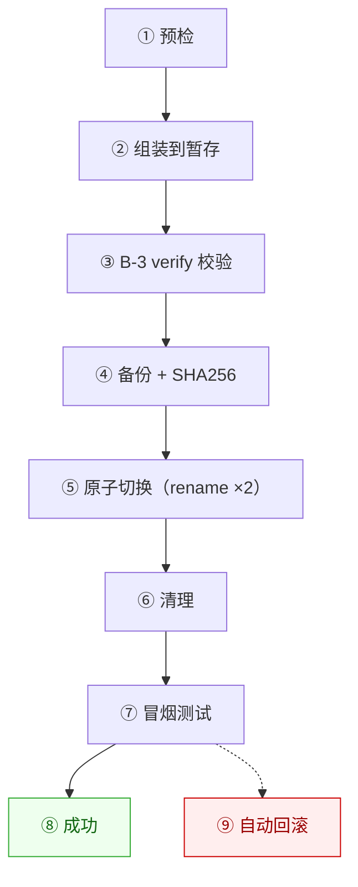

# 第二阶段 · 后端交付总览（B-3 / B-4）

> **阶段**：**第二阶段**「源码化收口与产物切换」· 后端并行线
> **任务编号**：**B-3**（资产管线）/ **B-4**（发布脚本设计）
> **依据**：`docs/delegation/15-第二阶段任务分发.md` §五
> **日期**：2026-10-14
> **状态**：🟢 **B-3 完成 · B-4 完成 · 一项施工阻塞项已提前关闭**

> ℹ️ **命名口径（2026-10-14 统一）**
>
> 项目**弃用「轮」**这一非正式编号，统一改用 **「阶段 + 任务编号」**。
> 本文件初版曾标「第三轮」（无依据，已撤销），继而一度归入「第二轮」（与第一阶段记录冲突）；
> 现统一为 **「第二阶段 · B-3 / B-4」**。
>
> 依据：`15-第二阶段任务分发.md` §五 把 **B-1 依赖锁定 / B-2 gitignore 复核 / B-3 资产管线 /
> B-4 发布脚本设计** 作为**同一批派单**（10-14 ~ 10-23），**不得拆轮**。
> 完整核查过程见 §七。

---

## 一、一句话结论

> **资产管线打通了，发布方案设计完了；顺带发现并关闭了一个"一次发布就把 GB 级数据提交进仓库"的隐藏地雷。**

---

## 二、交付清单

| 任务 | 交付物 | 状态 |
|---|---|---|
| **B-3** 资产管线（原 S8b-2） | `tools/asset-pipeline.cjs`（4 子命令）<br/>`tools/test-asset-pipeline.cjs`（**17/17 通过**）<br/>`docs/delegation/17-B3-资产管线报告.md` | ✅ |
| **B-4** 发布脚本设计（S8c 前置） | `docs/delegation/18-B4-发布脚本设计.md` | ✅ |
| **附带**：gitignore 缺口 #8 | `.gitignore` +5 条规则<br/>`tools/verify-gitignore.cjs` 断言 74 → **83** | ✅ |
| **附带**：B-2 复核记录同步 | `docs/delegation/16-B2-gitignore复核记录.md` 更新 | ✅ |

### 提交

```
7310216  B-3: 资产管线脚本 + 回归测试 + 报告
```

---

## 三、B-3 关键结论

### 3.1 上游可用性

| 项 | 结论 |
|---|---|
| `pokerogue-assets` 仓库 | ✅ 可达（145 refs） |
| 锚点 gitlink | `pokerogue@90df65097b6d` → `assets@4c6fac5fd9cb…343` |
| 完整拉取可行性 | ❌ **不可行** —— 最低吞吐 52 KB/s，758.8 MB 需 **4.2 小时** |
| 采用方案 | **降级方案**：以本地 `game/server/dist`（38061 文件 / 758.8 MB）为资产源 + `verify` 兜底 |

> **为什么按最低吞吐而非中位值？** 样本间差 49 倍（2539 vs 52 KB/s）。按中位值算只需 5 分钟，会诱导出一个"看着划算、实际卡死"的方案 —— 这正是第一阶段踩过的坑。

### 3.2 `verify` 六道检查的实测结果

| # | 检查 | 结果 |
|---|---|---|
| ① | 顶层目录结构 + 最低文件数 | ✅ 6/6 目录齐备 |
| ② | `index.html` / `manifest` 字面量引用 | ✅ 8/8 引用存在 |
| ③ | 零字节文件 | ❌ **18 个**（真损伤） |
| ④ | atlas 依赖（全域索引） | ⚠️ 26 处缺口（已定性为上游问题，不计失败） |
| ⑤ | 顶层异常文件 | ✅ 无 |
| ⑥ | 汇总 | 38061 文件 / 758.8 MB |

### 3.3 发现的真问题：18 个零字节空壳文件

`gitignore` 之外的另一类"静默损伤"。文件名解码：

| 显示名 | UTF-8 十六进制 | 解读 |
|---|---|---|
| `1这里背` | `31 e8bf99e9878c e8838c` | `"1"` + `"这里背"` |
| `1这里正` | `31 e8bf99e9878c e6ada3` | `"1"` + `"这里正"` |

**成因**：批处理/解包环节把中文目录名拼成了文件名，写出 0 字节空文件。

**影响**：运行时**无害**（加载器按 `{id}.png` 精确匹配，永不命中），但它是**拷贝可靠性的告警信号**。

> ⏸️ **清理动作待确认** —— 不自动删（属资产目录的破坏性改动，且铁律 R3 要求可回退）。
> 需要清理时说一声，我先做引用扫描再逐个删。

### 3.4 方法论收获（已写入报告与代码注释）

1. **`find -size 0` 会把目录算成 0 字节**（Windows 上目录 `st_size` 恒为 0）→ 必须用 `withFileTypes` + `isFile()`。
2. **用文件名配对判断资产完整性是错的** —— 该目录有 atlas 型（9875 个，声明依赖）和 palette 型（3545 个，颜色映射）**两套 json**；且 atlas 的 `image` **可跨目录引用**（`variant/10-342.json` 声明的 `18-mega.png` 实际在上一级）。
   - 按文件名配对：假阳性 **2800+**
   - 按 json 内容 + 同目录索引：377
   - 按 json 内容 + **全域索引**：**26** ← 正确判据
3. **参数解析必须支持 `--k=v`** —— 文档全用等号形式，早期只认空格形式会导致**静默忽略 + fallback 默认值**（最隐蔽的 bug 类型）。
4. **`req.setTimeout` 在涓流下载下永不触发** → 进程挂死。必须用**墙钟 Deadline**。

---

## 四、B-4 关键设计

### 4.1 三个实测确认的前提

1. **Electron 只是指向 `localhost:8000` 的浏览器**
   `nativefier.json`：`"targetUrl":"http://localhost:8000/"`（Nativefier 52.0.0 / Electron 25.7.0）

2. **两条路径共用同一份服务与产物**

   ```mermaid
   flowchart LR
       A["便携 Node 三条启动方式"] --> S["server.cjs :8000"]
       E["Electron 外壳"] -->|"HTTP"| S
       S --> D["game/server/dist/"]
   ```

   → **推论：「发布」= 替换 `dist/`。两条路径自动同时生效，不需要分别发布。**

3. **新产物是「构建输出」+「资产」的合并，两者都不完整**

   | 目录 | 构建产物（18 MB） | 发布目标（758.8 MB） |
   |---|:---:|:---:|
   | `assets/` `index.html` `locales/` | ✅ | ✅ |
   | `images/` `audio/` `fonts/` `battle-anims/` | ❌ | ✅ |

   → **发布流程必须显式包含"资产并入"这一步。B-3 与 B-4 是同一条管线的前后两段。**

### 4.2 方案对比结论

| 方案 | 判定 |
|---|---|
| A 原地覆盖 | ❌ 否决 —— 非原子、无回滚，违反铁律 R3 |
| **B 暂存 + 原子切换 + 备份** | ✅ **推荐** —— 可回滚、可验证、失败不停机 |
| C 多版本 + 软链 | ❌ 否决 —— Windows 需管理员权限，可移植性差，收益（亚秒窗口）远小于代价 |

代价（诚实说明）：需 **2× 磁盘**（峰值 2.3 GB）；切换瞬间有**亚秒级窗口**（单机游戏完全可接受）。

### 4.3 十步流程（含失败路径）



关键实现：Windows 上 `fs.renameSync` **不能覆盖已存在目录**，必须两步改名（先挪走旧的，再放上新的），并把窗口压到毫秒级。

---

## 五、附带发现并关闭的施工地雷

做 B-4 时核查「备份目录会不会被 gitignore 忽略」，结果是 —— **全都不被忽略**：

| 路径 | 体积 | 后果 |
|---|---|---|
| `game/server/.release-staging/` | 758 MB | 🔴 进仓库 |
| `game/server/backups/`（默认存 3 份） | **2.3 GB** | 🔴 进仓库 |
| `game/server/dist.old/` `dist.rollback-*/` `dist.broken/` | 各 758 MB | 🔴 进仓库 |

**若不修，B-4 脚本一落地就会把 GB 级数据提交进仓库。**

**修法**：新增 5 条规则（**逐条点名，不能用 `dist*` 通配** —— 那会误伤必须入库的 `game/server/dist/`）。

**验证**：
- 断言 74 → **83**，全绿
- 与真实 `git check-ignore` 交叉校验 **11/11 一致**
- 反向探针确认 `dist.older/`、`dist.rollback2/` **不被**误伤
- 已跟踪文件 **0/2210** 命中（零误伤）

---

## 六、交接与下一步

### 6.1 已解锁 / 未解锁

| 项 | 状态 |
|---|---|
| S8（服务层 + 发布管线） | 🟡 **部分解锁** —— 设计与工具就绪，脚本实现待 M5 后（依赖 A5-01 产物切换） |
| A5-01 产物切换 | 🔵 可按 B-4 的十步流程施工；`verify`/`snapshot` 可直接作为门禁 |
| B-3 的 18 个空壳清理 | ⏸️ 待确认 |

### 6.2 需要项目所有者 / 全栈确认

| # | 问题 | 影响 |
|---|---|---|
| 1 | **磁盘余量**：发布需 2.3 GB 峰值 | 不足则方案 B 不可行 |
| 2 | Electron 是否永远无需重打包？（仅当端口/`targetUrl` 变才需要） | 决定是否启动 B-4 阶段 3 |
| 3 | 18 个空壳文件是否清理 | 资产目录破坏性改动，需授权 |
| 4 | `docs/tech-stack-decision.md` §2.1 版本上界需更正（2025-09-22 → 锚点 `90df65097b6d`） | 文档一致性（我可顺手改，待确认） |

### 6.3 后端并行线完成度

> 全部 4 项同属 **第二阶段**（`15` §五 同一批派单）。

| 任务编号 | 任务 | 交付日期 | 状态 |
|---|---|---|---|
| **B-1** | 依赖锁定 + lockfile 校验 | 2026-10-14 | ✅ 完成 |
| **B-2** | `.gitignore` 与新目录复核 | 2026-10-14 | ✅ 完成（本批补缺口 #8） |
| **B-3** | 资产管线脚本 | 2026-10-14 | ✅ 完成 |
| **B-4** | 发布脚本设计 | 2026-10-14 | ✅ 完成 |

> **第二阶段后端并行线（B-1 ~ B-4）全部完成。** 下一步取决于 M5 / A5-01，届时按 B-4 设计落地 `release.cjs`。

---

## 七、命名口径核查与统一（2026-10-14）

### 7.1 动因

本文件初版标为「第三轮」，与同一文档 §6.3 把 B-1/B-2 标为「第二轮」**自相矛盾** —— 同一个派单批次被拆成两个轮次。据此全面核查编号口径。

### 7.2 核查方法

```bash
# ① 全仓库搜轮次表述
grep -rn "第一轮\|第二轮\|第三轮" docs/
# ② 追溯「第二轮」何时进入仓库
git log -S "第二轮" --pretty='%h %ad %s' --date=short -- docs/delegation/
# ③ 追溯交付文档的首次提交
git log --diff-filter=A --pretty='%h %ad %s' -- "docs/delegation/11-第一阶段-后端交付总览.md"
```

### 7.3 核查结果

| 结论 | 证据 |
|---|---|
| **「轮」不是项目正式编号概念** | 项目主线组织概念是**阶段**（`docs/archive/phase-1/` 通篇用"阶段"）与**方案版本**（`08-v2源码化优先-重构方案.md` 明确 v1→v2） |
| **「第一轮」全仓库无出处** | `grep -rn "第一轮"` 结果为空 |
| **「第二轮」仅 3 处，均由后端角色于 2026-10-13 写入** | `11-后端第二轮交付总览.md`、`09-并行工作清单.md`、`05-v2-任务看板.md`，三者**同批提交**于 `75ed2b9`（10-13 18:18），一致指向当日后端交付 |
| **「第三轮」全仓库仅出现在本文件初版** | 无任何独立依据 |
| **10-13 的后端工作属第一阶段** | 归档 `PHASE-1-归档报告.md` §2.8 收录 `S8a/S8b/S8d`；`14-整体进度报告.md` §2.8 同 |
| **第二阶段的 B-1 ~ B-4 是同一批派单** | `15-第二阶段任务分发.md` §五，起止 10-14 ~ 10-23，未在 B-2/B-3 之间划轮 |
| **其它角色不使用「轮」** | `11-前端-A0并行供料执行报告.md`、`03-后端工程师-派单.md` 均无轮次表述 |

### 7.4 统一口径（**已采纳，经项目所有者确认**）

**弃用「轮」，改用「阶段 + 任务编号」。**

| 归属 | 编号 | 内容 |
|---|---|---|
| **第一阶段** | **S8a / S8b / S8d**（+ A0 阻塞复核、A0-2 上游定位） | `server.cjs` 工厂化 / 日志系统 / 35 项测试 / `inventory-assets.cjs` / `tech-stack-decision.md` / `README-启动.md` |
| **第二阶段** | **B-1** | 依赖精确锁定 + `verify-lockfile.cjs` |
| **第二阶段** | **B-2** | `.gitignore` 复核 + `verify-gitignore.cjs` |
| **第二阶段** | **B-3** | 资产管线（本文件主体） |
| **第二阶段** | **B-4** | 发布脚本设计（本文件主体） |

### 7.5 已执行的全文统一

| # | 改动 | 文件 |
|---|---|---|
| 1 | 标题/页眉/§6.3 改为「第二阶段 · B-3/B-4」 | `23-第二阶段-B3-B4-交付总览.md`（原 `23-后端第三轮交付总览.md`） |
| 2 | 标题改为「第一阶段 · 后端交付总览」；文件名 `11-后端第二轮交付总览.md` → `11-第一阶段-后端交付总览.md` | `11-第一阶段-后端交付总览.md` |
| 3 | 「2026-10-13 第二轮」→「2026-10-13 第一阶段」（11 处） | `09-并行工作清单.md` |
| 4 | 「第二轮」→「第一阶段」（2 处） | `05-v2-任务看板.md` |
| 5 | 补编号消歧注（第一阶段 B-1~B-4 ≠ 第二阶段 B-1~B-4） | `09-并行工作清单.md` §四 |

> 改动前已确认 `11-后端第二轮交付总览.md` **无其它文档引用**，重命名不会断链。

> **编号消歧提醒**：第一阶段的 **B-1~B-4**（`09` §四：`server.cjs` 工厂化 / 日志 / 资产清单 / 便携 Node）
> 与第二阶段的 **B-1~B-4**（`15` §五：依赖锁定 / gitignore / 资产管线 / 发布脚本）
> **是两套独立编号，不连续、不继承**。引用时请带阶段前缀。
