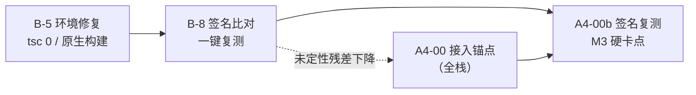

# B-8 · 签名比对工具（供 A4-00b 一键复测）

> **任务**：第三阶段 **B-8 签名比对工具化**（`24-第三阶段任务分发.md` §三）
> **交付**：`tools/verify-signature.cjs` + 基线报告 `B-8-签名比对报告-基线.md`
> **日期**：2026-10-14 · **状态**：✅ 完成（工具可用；**基线已出**）

---

## 一、它解决什么问题

A4-00b（**M3 硬卡点**）要求「残差按三类定性 + 核心上游符号 100% 命中」。A3-13 当时是**手工**做的（§5），无法一键复跑。
本工具把它固化为一条命令，并把 A4-00b 的判据直接映射到输出。

```bash
cd /d/Work/Pokemon/new
export PATH="$PWD/.build-tools/node-v24.9.0-win-x64:$PATH"

node tools/verify-signature.cjs --scan-vendor     # 首次：建第三方符号集缓存（约 4.5 min）
node tools/verify-signature.cjs                   # 之后：秒级
node tools/verify-signature.cjs --out=报告.md     # 同时落盘
node tools/verify-signature.cjs --gate            # 不过则 EXIT=1
```

---

## 二、方法：两侧提取方式不同，但语义相同

| | 基准（modder 发行产物） | 候选（自构建产物） |
|---|---|---|
| 构建器 | rollup + **esbuild** | rolldown + **oxc**（vite 8，B-5 恢复后） |
| 标识符 | **被混淆** | **原样保留** |
| keepNames 机制 | 注入注记 `<helper>(<x>,"原名")` | `output.keepNames` = **不混淆**，**无注记** |
| 提取方式 | 解析注记 → 原名集合 | 抽标识符集合 |

**为什么候选不能也用注记**：实测 rolldown 掌控命名，`--minify esbuild` 也**不产生注记**。
两侧机制不同，但回答同一个问题「这个 bundle 里有哪些符号」。

**自证**（不是自我断言）：候选侧对 `24` §0.4 ④ 列出的核心上游符号 **11/11 命中**。

### ⚠️ 助手名必须自动探测，不能硬编码

注记里的 helper 名也被压缩过 —— modder 产物里是 `l`（2584 个符号）与 `r`（546 个）。
工具按「贡献符号数 ≥ 阈值」自动采信，并可用 `--helpers=` 手动覆盖。

### 🔴 抽标识符必须先剥字面量，而剥离器必须识别正则

第一版剥离器**漏了正则字面量**：minified 代码里满是 `/["']/g` 这类正则，
其中的引号把朴素扫描器带进「字符串模式」而成片吞码 ——
**6.15 MB 被剥成 1.22 MB**，连 `Move` / `Ability` 都丢了，覆盖率算出 **18.85% 的假低谷**。

修正后（按前一个有效字符判断 `/` 是除法还是正则起始）：保留率 **91.0%**，**26040** 个 token，
核心符号全部命中。**这条已写进工具注释，勿删。**

---

## 三、基线结果（A4-00 **之前**）

| 指标 | 值 |
|---|---:|
| 基准符号总数（modder 产物） | **3125** |
| 命中 | **1936** |
| **覆盖率** | **61.95%** |
| 未定性残差 | 1127 |
| tree-shake 差异 | 5 |
| 依赖噪声 | 57 |
| **核心上游符号** | **11 / 11 ✅** |

**对比 A3-13**：其在 vite 7 **降级环境**下测得 58.51%。B-5 恢复原生工具链后升至 **61.95%**。
> ⚠️ 两个数字**方法不完全相同**（A3-13 是注记对注记，本工具是注记对标识符），
> **不宜直接相减**；应把本工具的 61.95% 作为 A4-00 前后的**同口径对比锚点**。

### 3.1 已满足的 A4-00b 判据

| A4-00b 条件 | 现状 |
|---|---|
| ④ 核心上游符号 100% 命中 | ✅ **11/11 已满足**（B-5 修复工具链的功劳） |
| ⑤ 11 个自研系统符号全部命中 | ⬜ 待 A4-00（接入锚点） |
| ② 残差中「迁移缺陷」类 = 0 | ⬜ 待 A4-00 |
| ③ tree-shake / 依赖噪声逐条定性 | 🟡 工具已分桶（5 / 57），可逐条过 |

---

## 四、🔴 「未定性残差」不等于「迁移缺陷数」

这是使用本工具**最容易误读**的一点。该桶混合了两类：

| 构成 | 说明 | A4-00 后 |
|---|---|---|
| ① modder 新增符号 | 11 个自研系统（实测样例：`TalentRegistry`、`TagRegistry`、`setHealerConversionTargetProvider`…） | **应落进 `src/`** → 转为命中或「tree-shake 差异」 |
| ② 被摇掉的第三方内部符号 | 如 Phaser 的 `jsonURL` / `equalpower` | 仍在，与迁移无关 |

**② 无法从 `node_modules` 反查**：Phaser 的发行 dist **本身已压缩**，
实测扫描 16883 个 JS 文件（237.6 MB）只多识别出 **20** 个符号。
所以「依赖噪声」桶天然偏低，残余的第三方符号会留在「未定性」里。

**因此 A4-00b 的正确用法**：

1. A4-00 完成后重跑 → 「未定性残差」应**大幅下降**（① 被消掉）
2. 残下的（基本是 ②）逐条确认后写入白名单 → `--allow=<file>`
3. `--gate` 通过 ⇔ 核心符号 100% 且未定性残差**已全部白名单化**

```bash
node tools/verify-signature.cjs --gate --allow=docs/sourcemigration/签名白名单.json
```

---

## 五、局限（如实说明）

| # | 局限 | 影响 |
|---|---|---|
| 1 | 候选侧用「标识符存在性」判定 | 若某符号仅出现在字符串里会被漏判；已用**剥字面量**缓解（保留率 91%） |
| 2 | 剥离器非完整 JS 词法 | 模板字符串 `${}` 嵌套计数未实现；对「存在性」判定影响可忽略 |
| 3 | 第三方符号集依赖扫描 `node_modules` 原始文本 | 对**已压缩**的发行 dist（Phaser）无效，见 §四 |
| 4 | 基准符号数受 helper 探测阈值影响 | `--min-helper` 可调；报告会打印助手分布供核对 |
| 5 | 不能替代人工定性 | tree-shake 差异类仍需逐条确认「本应存在」 |

---

## 六、与其它交付的关系



- **B-5 是前提**：不恢复原生工具链，签名基线不可信（这正是 O-5 裁定「先修完才能判 M3」的技术依据）
- **A4-00 是另一半**：B-8 只能测出「缺什么」，补不了「为什么缺」——接入锚点必须由全栈做
